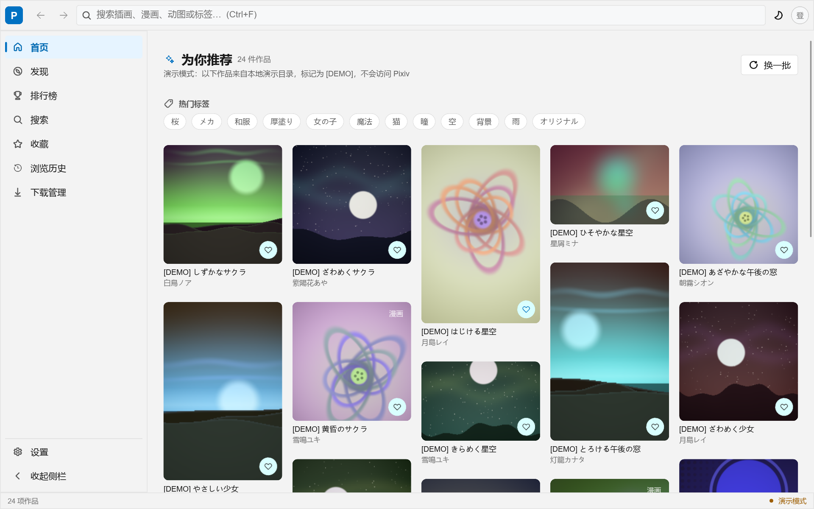
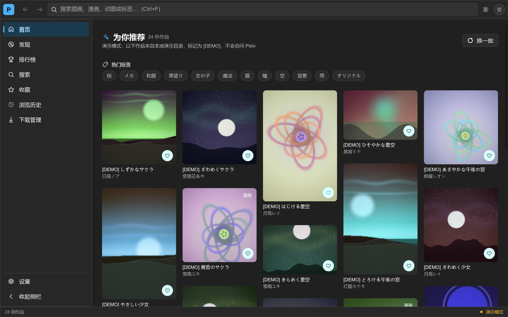
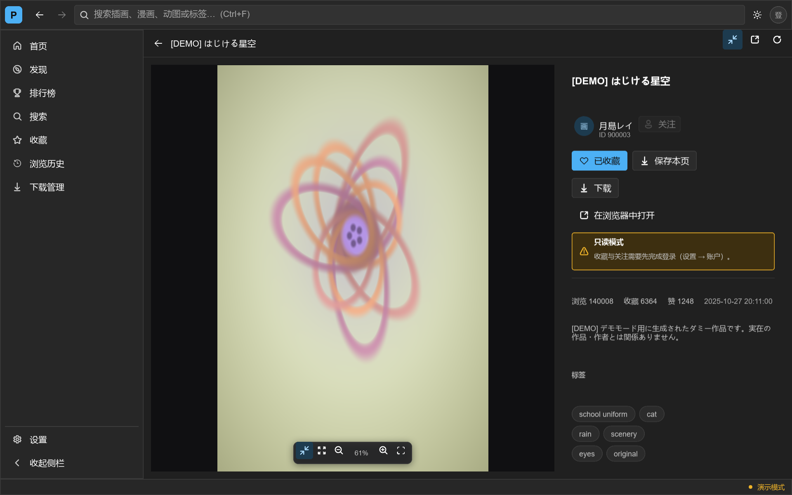
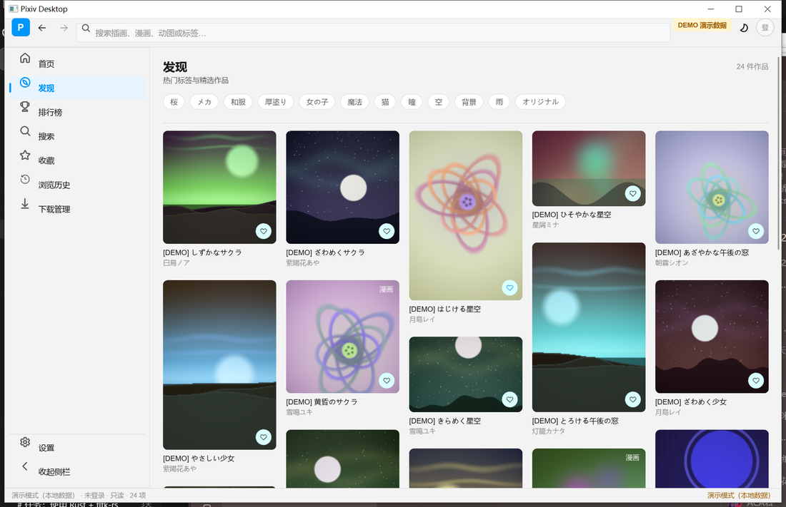
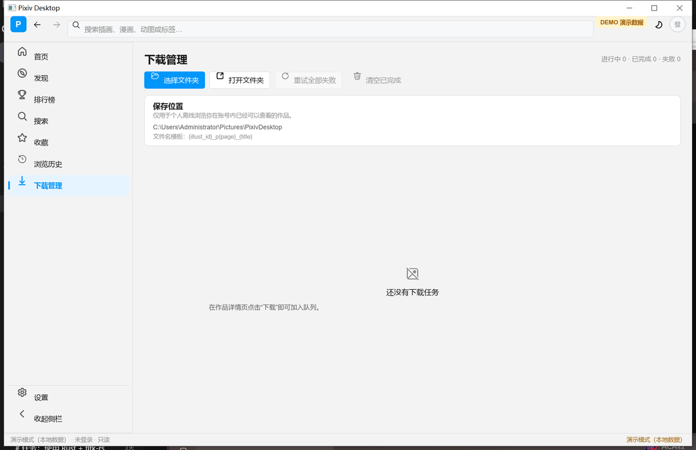
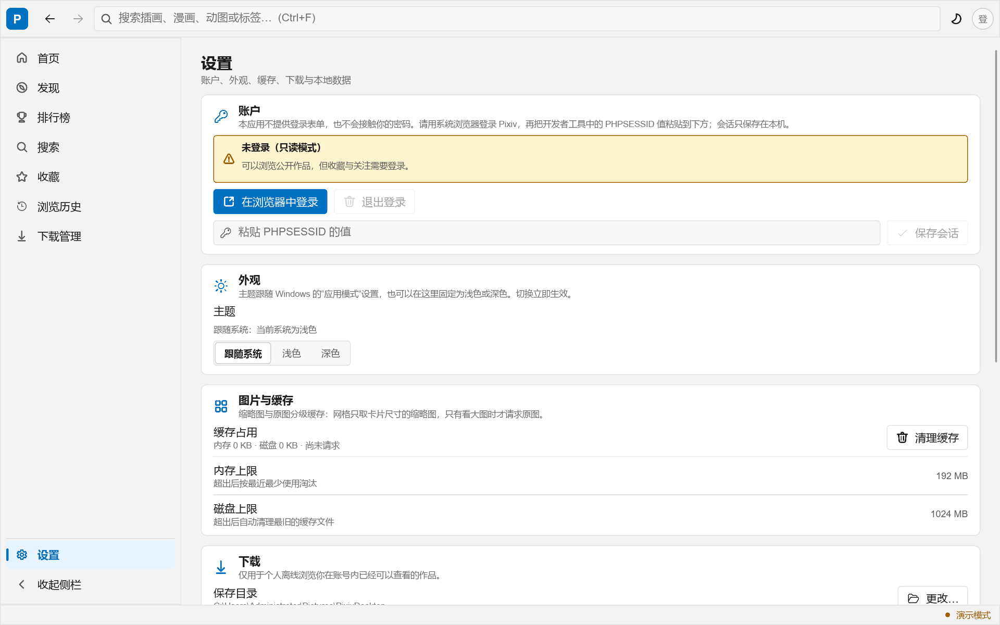
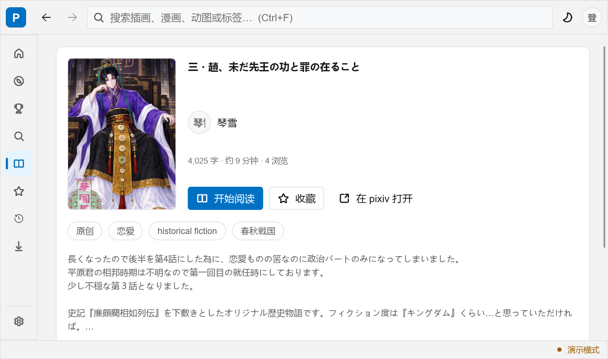
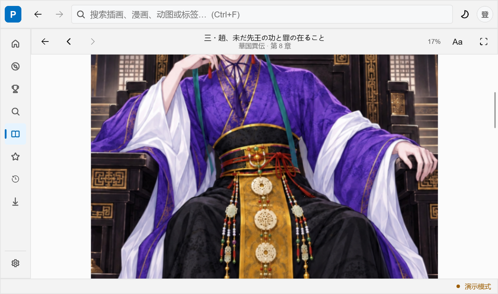
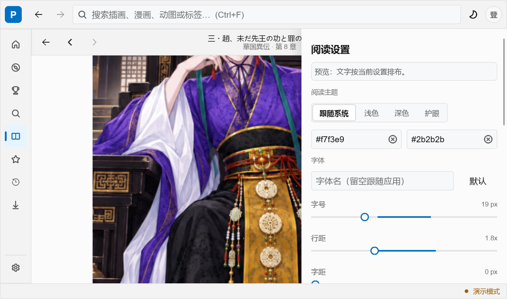

# Pixiv Desktop

A native desktop client for [Pixiv](https://www.pixiv.net/), built with **Rust + Slint**.
No Electron, no CEF, no Tauri, no WebView — the UI is compiled Slint drawing directly
through a GPU/software renderer.

Visual target: **70 % Windows 11 WinUI 3 / Fluent Design 2 + 30 % Pixiv web**. The
shell is a native desktop one — NavigationView-style rail with a compact mode, a
command bar with search/back/forward/account, a Settings page built from cards and
segmented controls, InfoBars, flyout-style tooltips, real
hover/pressed/disabled/focus states, and one Light/Dark/System theme that covers
every page. Pixiv supplies the part that matters for browsing: its blue accent, an
illustration-first masonry feed with no chrome competing against the artwork, tag
chips, and the detail page's image-dominant layout with a compact metadata column.

| Home (light) | Home (dark) |
| --- | --- |
|  |  |

| Detail (dark) | Discover |
| --- | --- |
|  |  |

| Downloads | Settings |
| --- | --- |
|  |  |


| Novel page | Novel reader |
| --- | --- |
|  |  |

| Reading settings |
| --- |
|  |

Novel captures are taken with `PIXIV_DESKTOP_NOVEL_FIXTURE` pointing at a trimmed live
capture (`fixtures/novel_detail.json`), so they are deterministic and contain no session.

Screenshots are captured by `tools/shot.ps1` at 1280×800 logical on a 150% DPI
display, cropped to the client area so a pixel can be mapped to a logical
coordinate. The curated set above is tracked; everything else stays local (see
`.gitignore`).

Icon alignment, colour contrast, the pixels themselves and what assistive
technology can reach are **measured, not reviewed**:
`tools/verify-icons.ps1` finds glyph ink centres in a real capture and fails if any
of them drifts from its row; `tools/verify-visual.ps1` diffs 20 forced-demo
captures against tracked baselines; `tools/verify-a11y.ps1` reads the UI
Automation tree (roles, names, invokable patterns) and walks Tab until focus cycles with
real keystrokes; `tools/verify-focus.ps1` captures what those keystrokes produce and
measures the 2px focus ring at each stop, reading the colour out of `ui/theme.slint`
rather than restating it; `tools/verify-dpi.ps1` runs the scale ladder at 100/125/150/200%
through Slint's own `SLINT_SCALE_FACTOR` and fails any scale whose decode target is
below the drawn card size; and `cargo test` checks WCAG contrast ratios, the "no raw
glyph outside the icon containers" rule, the `#RRGGBBAA` byte order of translucent
colours, that every interactive component declares a role, that a focus scope sits
under the click target, that no `key-pressed` handler compares against a key
*name*, and that every declared motion token has a user and no `animate` carries a
literal duration. All of it is described in [`docs/UI-NOTES.md`](docs/UI-NOTES.md)
§ 7–9, § 12 and § 13.

The engineering record for the layout work — root causes, fixes and what could
not be verified here — is in [`docs/UI-NOTES.md`](docs/UI-NOTES.md).

---

## 1. What works

| Area | Status |
| --- | --- |
| Native window, Fluent shell, collapsible nav rail, responsive reflow | **Implemented** |
| Light / Dark / **System** theme (follows the Windows app mode), switchable at runtime, persisted | **Implemented** |
| Illustration grid with height-balanced masonry (per-card aspect ratio, no cropping, column count measured from the real content box) | **Implemented** |
| Demo Mode with procedurally generated artwork | **Implemented** |
| Real Pixiv data: illustration detail, page list, search, ranking, artist work ids, tag metadata | **Implemented** (verified against the live API) |
| Zoomable image viewer: wheel zoom anchored at cursor, drag pan, double-click toggle, fit / 1:1, fullscreen | **Implemented** |
| Image pipeline: priority queue, single-flight, memory LRU + disk tier, generated fallbacks | **Implemented** |
| Local SQLite: search history, view history, settings, download records — and a History page that reads them back | **Implemented** |
| Download queue: bounded concurrency, filename templates, cancel / retry, duplicate detection, atomic writes | **Implemented** |
| Ugoira decode + timing + **in-app playback** + GIF export | **Implemented** — the viewer plays the film from a monotonic clock under a 64 MB budget, and GIF export still exists |
| Multi-select on every grid page, with batch download and batch bookmark | **Implemented** — Ctrl/Shift-click or the page's own toggle, a 50-work cap, and a summary that names what was skipped |
| Command palette (`Ctrl+P`): pages, actions, recent views, and a pasted artwork or user URL | **Implemented** — one parser for `/artworks/1234`, `/en/artworks/1234`, `id=`, a bare id, `/users/5678` and `@name` |
| Bookmark visibility (public / private) with a split button and re-tagging | **Implemented** — the state is always the server's reply |
| Download queue: pause / resume per row or all, throughput and a per-row ETA | **Implemented** — a resumed row restarts its body (see limits) |
| Session login via system browser + `PHPSESSID` | **Implemented** |
| Bookmark / follow mutations | **Implemented** and verified against a live account — see [`docs/NETWORK-TEST-REPORT.md`](docs/NETWORK-TEST-REPORT.md) row 8 |
| Novel reader | **Implemented** — native page, Pixiv body markup parsed into rows (ruby, embedded images, page breaks, chapter headings), 19 typography settings persisted to SQLite, reading position and history, series chapters, immersive mode. See `docs/NOVEL-READER.md` |
| Novel search, novel page, recent reading | **Implemented** — `/ajax/search/novels/`, `/ajax/novel/{id}`, `/ajax/novel/series_content/{id}`; the rail has a 小说 entry with its own search box, results list and recent-read list |
| Comments, "related works" | **Not available** — no usable endpoint shape found |
| `/ajax/discovery/artworks` (the For-you and recommended-artist bands) | **Implemented** — verified 200 for every mode (see [`docs/API-NOTES.md`](docs/API-NOTES.md)) |

### Honest limits

These are real, not hedging. They are listed because a client that quietly guesses is
worse than one that says what it does not know.

1. **Pixiv has no public third-party OAuth registration.** There is no client
   credential a self-built desktop client can legitimately hold. The working credential
   is therefore the session cookie from the user's own browser. This app never renders a
   login form and never sees a password.
2. **`cargo clippy` cannot run in this build environment.** MSYS2's `cargo-clippy`
   re-executes an MSVC rustup toolchain and dies with `linker link.exe not found` before
   reaching any project code; this reproduces on dependency-only crates. The equivalent
   gate that *does* run, and was used for every crate here, is:
   ```
   $env:RUSTC_WORKSPACE_WRAPPER="C:\msys64\ucrt64\bin\clippy-driver.exe"
   cargo check --workspace --all-targets
   ```
   This was verified to emit genuine clippy lints (a probe crate produced
   `clippy::bool_comparison` and `clippy::unnecessary_first_then_check`), not a plain
   `rustc` check.

   One catch, found while writing `tools/gates.ps1`: `RUSTC_WORKSPACE_WRAPPER` is not
   part of cargo fingerprints, so on an already-built tree this command prints
   `Finished` and lints nothing. The gate therefore points `CARGO_TARGET_DIR` at
   `target/lint` so it always has artifacts to produce; a deliberate
   `bool_comparison` probe was used to prove it reports lints. CI runs plain
   `cargo clippy -D warnings` on an MSVC toolchain instead.

   A second catch, found by pushing: **the local toolchain and CI's are different
   versions, and one lint existed in only one of them.** `Atomic::<u64>::fetch_update`
   is deprecated in 1.99 (renamed `try_update`) and is the only name in the 1.98 this
   machine builds with, so a green local run pushed a red `Clippy` job. The code no
   longer names either (a compare-exchange loop), and `tools/gates.ps1` re-runs its
   lint gate through the newer toolchain when one is installed, reporting both
   versions in the table. Planted back as a defect, the 1.98 gate passes and the 1.99
   gate fails with the message CI printed — that experiment is what makes it a guard.
3. **Bookmark and follow POSTs were confirmed end-to-end against a live account** — add,
   delete, follow and unfollow all mutate the real account, recorded in
   `docs/NETWORK-TEST-REPORT.md` row 8. They still never fake success: an error surfaces as
   an error, and a bookmark only changes state after the server confirms it.
4. **Related works and comments returned no usable shape** (400/404 for every parameter
   combination tried) and are not modelled. `/ajax/discovery/artworks` does answer 200 and
   carries the For-you band; the discovery page completes it with ranking + search + tag
   metadata rather than guessing. See `docs/API-NOTES.md`.
5. **Native folder picker — implemented** (`SHBrowseForFolderW`, the resizable shell
   dialog). The chosen directory is persisted and applies to the next task immediately;
   `DownloadManager::set_directory()` exists, so no restart is needed.
6. **Ugoira — playback in the viewer, and GIF export.** The detail page decodes the
   archive once at the width it draws (`UgoiraFilm::scaled_to_width`), publishes it
   under a 64 MB budget that thins frames by stride and says so when it does, and
   advances it from a monotonic clock rather than by counting ticks — a late frame
   repaints the frame that should be on screen instead of slowing the film down.
   **导出动图 GIF** still writes the film next to your other downloads. The demo
   catalogue carries a 24-frame film so the state can be captured and tested offline.
7. Ugoira export writes **animated GIF only** (WebP animation encoding is not in the
   `image` crate).
8. **The layout is measured, not assumed.** Slint reports the content box it actually
   resolved and Rust derives the column count from that number; there is no polling and
   no second source of truth for the window width. The shell's three rows are pinned by
   measurement, not by stretch: see `docs/UI-NOTES.md` § 3 for the constraint-propagation
   bug that used to leave the bottom half of a maximised window unpainted, and § 6 for the
   harness that now proves it is gone (`tools/verify-layout.ps1`: 8 pages × 3 sizes, all
   with `gap=0`).
9. **The system-theme watcher polls, and says so.** Slint 1.18 exposes no colour-scheme
   notification and no reachable window procedure, so while the theme mode is `System` a
   5s timer reads one registry DWORD (`AppsUseLightTheme`). It stops itself the moment a
   fixed theme is chosen. A push notification would need a raw window procedure, which
   this app does not have because it keeps the native frame.
10. **The keyboard reaches every control, and the page still does not follow it.**
    Round nine added a coverage assertion — every focusable `Button`, `ListItem` and
    `Edit` must be walked by Tab or the page fails — and it promptly found three
    controls per page that were focusable and unreachable (a duplicated search field,
    the account button, the session field). All eight pages now walk every one of them
    (`reached == required` on each). What is still wrong: focus does not scroll the
    page, so past the fold a keyboard user tabs into artwork that is not on screen.
    The seam exists (`IllustCard.gained-focus` → `card-focused(id)`) and the offset
    needs the card's content-space position, which only the page can compute; that
    component is next round's first item. Chips are real stops now — roving focus is
    not expressible in Slint 1.18, because a `FocusScope` with `enabled: false` still
    reports itself focusable — so a chip row costs one stop per chip.
11. **1920×1080 at 150% DPI was not captured.** That needs a 2880×1620 physical client
   area and this screen is 2560×1600, so `tools/verify-icons.ps1` reports the clamp and
   skips instead of measuring a truncated frame. Every other size in the matrix was
   measured.
12. **A resumed download starts its body again.** Pause frees the row's permit
   immediately (the in-flight request is abandoned through the same cancellation a
   cancel uses) and holds the row at its place in the queue, but nothing resumes over
   HTTP Range: the body is fetched again from byte zero. That is why a resumed row
   restarts rather than continues, and why a pause costs bandwidth on a metered
   connection.
13. **Batch actions need a session.** Batch bookmark is a sequence of real
   `set_bookmark` calls and batch download a sequence of page lookups; without a signed-in
   session the first reports `Unauthorized` per row and the second falls back to each
   work's largest image. The cap, the de-duplication and the summary are unit-tested;
   the network path has not been run against a live account for batches.

---

## 2. Build and run

Requires a Rust toolchain (developed on 1.98.1) and, on Windows, a C toolchain for
`rusqlite`'s bundled SQLite (UCRT64 gcc works).

```powershell
cargo build --release
cargo run --release
```

The debug binary also runs and is what the screenshots above were taken with.

### Visual verification

Layout claims are checked against the screen, not against a compiler exit code:

```powershell
# one screenshot, ground truth (BitBlt of the window rect, cropped to the client
# area; a sidecar JSON records the scale factor and the screen bounds)
pwsh -File tools/shot.ps1 -Page home -Mode maximize -Out docs/screenshots/home.png
pwsh -File tools/shot.ps1 -Page settings -Mode size -Size 1024x768 -Dark -Out .../s-dark.png

# a face and a work cannot be reached without input, so both have a deep link:
$env:PIXIV_DESKTOP_START_USER="104439010"; pwsh -File tools/shot.ps1 -Page profile ...

# tooltips only appear on hover, which this host cannot synthesise. -Tip comes
# from PIXIV_DESKTOP_TIP=1 and raises one over the back button for capture.
$env:PIXIV_DESKTOP_TIP="1"; pwsh -File tools/shot.ps1 -Page home ...
pwsh -File tools/shot.ps1 -Page detail -Illust 700000003 -Dark -Out .../detail.png

# every page x every size, asserting the shell invariant from the app's own trace
pwsh -File tools/verify-layout.ps1        # 24 checks: 8 pages x 3 sizes

# icon alignment, measured from pixels rather than from the Slint source
pwsh -File tools/verify-icons.ps1         # add -Size 800x600 / -Dark

# pixel regression: every page-state the capture harness knows, in both themes,
# diffed against tracked baselines. The run prints one row per capture and the total
# it compared, so the count is read from the gate instead of remembered here. The
# script forces PIXIV_DESKTOP_DEMO=1, which is what makes a baseline both
# deterministic and free of the signed-in user's own feed. Re-baseline with
# -Update after a deliberate visual change, and read the diff before committing. A
# capture must clear both a 0.02 % and a 96-pixel ceiling, and a capture that was
# skipped because the host scale differs is not a pass (the run exits 77).
pwsh -File tools/verify-visual.ps1

# accessibility: reads the UI Automation tree the way a screen reader does
# (roles, names, invokable patterns) and then walks Tab until focus cycles - one full
# cycle, not a fixed sample - asserting the numbers pinned in tools/a11y-budget.json.
pwsh -File tools/verify-a11y.ps1          # -Report to measure without failing

# ...and what those keystrokes produce on screen: presses Tab across three pages,
# reads each focused element's rect from UI Automation and counts pixels of the
# focus ring. Its captures are harness output under docs/screenshots/baseline/focus-*
# and are untracked: the file it measures is always the fresh one in target/focus.
pwsh -File tools/verify-focus.ps1          # -MinPixels to force the failure path

# the DPI ladder, both halves: four real scale factors measured from the app's own
# trace, and a numeric sweep (1060 points, 168-300 logical px, 1/1.25/1.5/2x) that
# fails any row whose decode target is below the drawn card. Reads the two constants
# out of src/images.rs by name (a mirror that cannot be parsed exits 77 rather than
# guessing). Exits 77 (SKIP) when the app cannot start at all, or when fewer scales
# were measured than requested - a gate that cannot run here did not fail.
pwsh -File tools/verify-dpi.ps1
```

Hover and keyboard interaction are synthesised, not assumed: `tools/drive.ps1`
sends real pointer moves, clicks, wheel notches and keystrokes
(`SetCursorPos` + `mouse_event` + `SendKeys`), and dot-sourcing it gives the
whole set as functions. `-Tip` remains only because it is deterministic.

`shot.ps1` restores the window before resizing (a resize delivered to a
never-restored window is dropped by the backend) and copies the screen rather than
calling `PrintWindow`, which renders the app's own surface and can therefore lie
about layout.

### Verification gates

```powershell
# every gate, in order, with per-gate timing - this is the list
pwsh -File tools/gates.ps1

# ...and the measured UI gates as well - all of them. They are opt-in because they launch
# the app, read its accessibility tree and copy the screen, which a CI runner
# without an interactive desktop cannot do. A gate that exits 77 is reported as
# SKIP, not FAIL.
pwsh -File tools/gates.ps1 -Ui

# or one at a time
cargo fmt --all -- --check
cargo test --workspace --locked              # the run prints its own case count. The design
                                            # rules over ui/*.slint live in src/uiaudit.rs; the
                                            # live suite returns early without PIXIV_LIVE_PHPSESSID
                                            # instead of failing, so a green run names that number
cargo build --release

# lint (see limit 2 for why not `cargo clippy`)
$env:RUSTC_WORKSPACE_WRAPPER="C:\msys64\ucrt64\bin\clippy-driver.exe"
cargo check --workspace --all-targets
```

`.github/workflows/ci.yml` runs the host-independent gates on every push: `cargo fmt`
(ubuntu), `actionlint` (a container), and on `windows-latest` `cargo check` over the
three-OS matrix, `cargo clippy -- -D warnings` and the test suite. A `gates` job then runs
`tools/gates.ps1 -SkipTest -SkipBuild`, which is what finally runs
`tools/selftest-gates.ps1` - the negative experiment every gate change is accepted on -
off this one machine, and the summary job depends on it, so a failing gate fails the one
status branch protection watches. That job omits `-Ui` on purpose: the measured UI gates
launch the app, read its accessibility tree and copy the screen, which a runner without
an interactive desktop cannot do, so they stay opt-in locally. It does **not** run the
release build (that is `.github/workflows/build.yml`). The live suite stays inert without
`PIXIV_LIVE_PHPSESSID`, so CI never talks to pixiv.net.

### Live tests against the real service

The suite above never opens a socket. There is a second suite that talks to
`www.pixiv.net` with a real session, and it is **inert unless you opt in**, so
`cargo test` can never pick it up by accident:

```powershell
$env:PIXIV_LIVE_PHPSESSID = '<your PHPSESSID value>'
cargo test -p pixiv-api --test live -- --test-threads=1
```

It reads the cookie from the environment only and never writes it anywhere. The
write tests follow read → mutate → **re-read** → restore → re-read, and refuse to
touch a target that is already in the wanted state, so running them does not
leave changes on the account.

`docs/NETWORK-TEST-REPORT.md` records what a full live run against the real
service produced, and `tools/gui-lib.ps1` is the UI Automation driver used to
click through the actual Slint window.

---

## 3. Signing in

Pixiv issues no OAuth client credentials to third-party desktop clients, so this client
reuses the session you already have:

1. Click **在浏览器中登录** in Settings — it opens `pixiv.net` in your **system browser**.
2. Sign in there as usual.
3. Open DevTools → Application → Cookies → `https://www.pixiv.net` → copy the value of
   `PHPSESSID`.
4. Paste it into the session field and press **保存会话**.

The app validates the cookie against a real authenticated endpoint before storing it, and
writes it to `session.bin` in the app data directory, sealed with DPAPI
(`CryptProtectData`, user-scoped) so the file is useless on another account or machine;
on non-Windows targets it falls back to a `0600` file. It is never written to SQLite and
never logged. **退出登录** deletes the file and reverts to Demo Mode.

Nothing about the app is required to sign in: detail pages, pages, search, ranking and
artist work lists all work unauthenticated.

---

## 4. Demo Mode

Demo Mode exists so the UI is fully explorable with no account and no network.

* Every demo URL uses the `demo://` scheme, so any code path reaching the network with
  demo data is an obvious bug.
* Every demo title carries a `[DEMO]` prefix, the top bar shows a **DEMO 演示数据** badge
  and the status bar reads **演示模式（本地数据）**.
* Artwork is generated procedurally at runtime from a seeded PRNG — no third-party imagery
  is bundled, so there is no licensing question.
* Demo Mode is a separate data source; it never parses or imitates a Pixiv response.

---

## 5. Architecture

```
pixiv-desktop      UI (Slint) + application wiring
├── pixiv-demo     demo catalogue + procedural artwork
├── pixiv-download download queue, filename templates
├── pixiv-image    priority cache: memory LRU + disk tier + single-flight
├── pixiv-store    SQLite persistence
├── pixiv-api      HTTP transport: session, retry, rate limiting
└── pixiv-types    wire + domain contracts (no I/O, no UI)
```

Dependencies point one way; `pixiv-types` depends on nothing but `serde`.

**Why a data-contract crate.** Pixiv's JSON is inconsistent in ways that are only
discoverable by observing it: ids are strings on `ajax/*` but numbers on `ranking.php`;
`illust_detail.tags` is a single object while other payloads send arrays; `ranking.php`
sends `"illust_type":"0"` as a string; `mime_type` is snake_case on one endpoint only;
`createDate` is sometimes an object. All of that is normalised exactly once, in
`pixiv-types`, and pinned by tests that parse **real captured responses** in `fixtures/`.
When Pixiv changes a payload, those tests fail before the UI does.

**Threading.** The Slint event loop owns the main thread. One tokio runtime handles
network, decode and database work. Slint models are `!Send`, so background tasks return
only plain bytes and the UI thread builds `slint::Image` values — no pointer sharing, no
locks around models.

**Why native window decorations.** Slint can draw a custom title bar with
`no-frame: true`, but dragging, Snap Layouts, per-monitor DPI and accessibility then all
have to be rebuilt on `Window::set_position`, which is jittery and loses Win11 snapping.
The native frame is kept and Fluent chrome is drawn inside it.

**Tooltips.** One `HoverTip` for the whole window, declared in `main.slint` after
every page and fed by the `Tip` global in `ui/tip.slint`. A tooltip is the only
element that must be drawn *outside* the control that owns it, and a child element
can neither escape an ancestor `clip` nor paint over a sibling declared later -
both of which had silently removed the affordance (see `docs/UI-NOTES.md` § 11).

**Icons.** Generated by `tools/fetch_icons.ps1` from
[Microsoft Fluent UI System Icons](https://github.com/microsoft/fluentui-system-icons)
(MIT). Only the path geometry is embedded, emitted as Slint `Path` elements, so icons
inherit theme colour and stay crisp at any DPI. No emoji, no hand-drawn substitutes.

A glyph is never positioned by hand: `IconPresenter` centres one inside a box the
caller owns, `IconSlot` centres one on the row it sits in, and a test fails the build
if any other file names `FluentGlyph` directly. Two measured facts made that rule
necessary — a `Path` defaults to `(0,0)` regardless of its size, and a fixed-height
child of a `HorizontalLayout` is top-aligned, not centred. See
[`docs/UI-NOTES.md`](docs/UI-NOTES.md) § 7.

Full detail: [`docs/ARCHITECTURE.md`](docs/ARCHITECTURE.md) ·
API observations: [`docs/API-NOTES.md`](docs/API-NOTES.md)

---

## 6. Keyboard shortcuts

| Key | Action |
| --- | --- |
| `Ctrl+F` | Focus search |
| `Ctrl+K` | Focus search (the other half of the pair every search box has) |
| `Alt+←` / `Alt+→` | Back / forward through page history |
| `Ctrl+1` … `Ctrl+7` | Home, Discover, Ranking, Bookmarks, History, Downloads, Settings (`Ctrl+,` also works for Settings) |
| `Ctrl+R` | Refresh the page in front of you: the feed on a feed page, the work on the detail page, the queue on downloads |
| `Ctrl+P` | Command palette: go to a page, run an action, or open a pasted artwork / user id or URL |
| `Ctrl+A` | Select every loaded work, while the grid is in selection mode |
| `Esc` | Close the topmost surface: the suggestion panel, then selection, then the detail page |
| `←` / `→` | In the viewer: previous / next page (with the thumbnail strip focused as well) |
| `Space` | On a ugoira work: play / pause the film |
| `Ctrl+click` / `Shift+click` | On a card: toggle it into the selection / select the range from the last one |
| wheel | Zoom the viewer, anchored at the cursor |
| double-click | Toggle zoom at the cursor |
| `F` | Fit to window |
| `1` | Actual size |
| `F11` | Fullscreen |

---

## 7. Legal

This is an unofficial client and is not affiliated with Pixiv Inc. It reads data the
signed-in user can already view in their own account, for personal browsing and offline
use. It deliberately contains **no bulk-scraping facilities** (no artist-wide crawlers, no
pagination bots) and no access-control bypass. Respect the rights of the artists whose
work you view.
