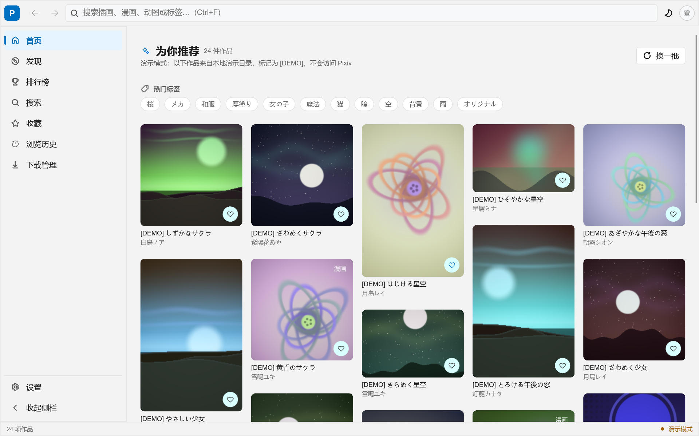
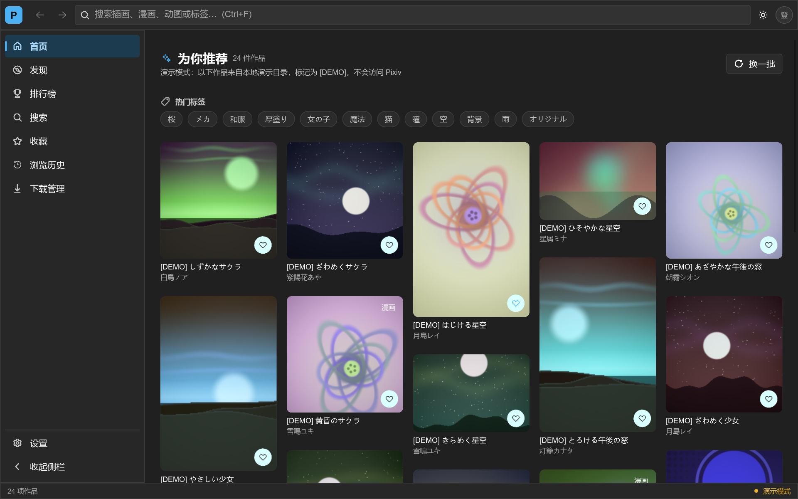
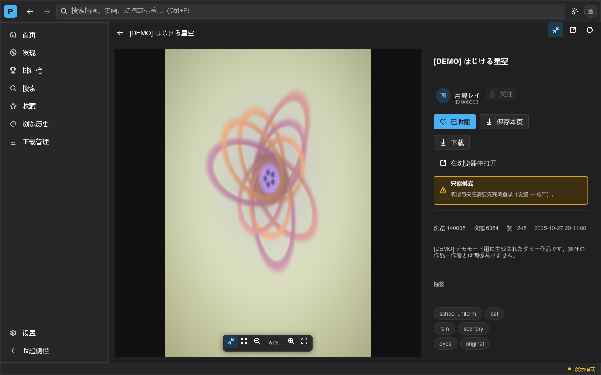
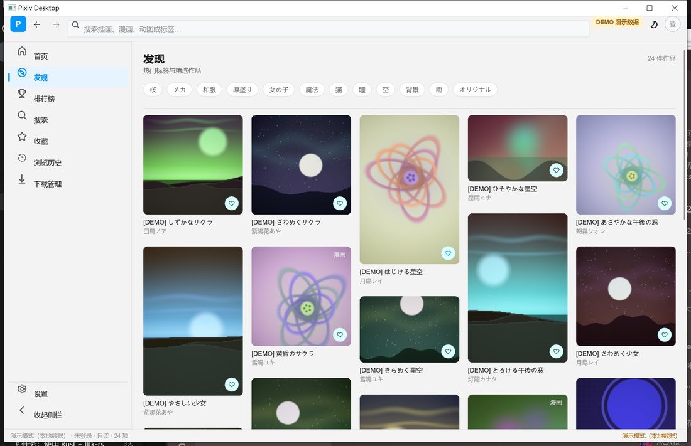
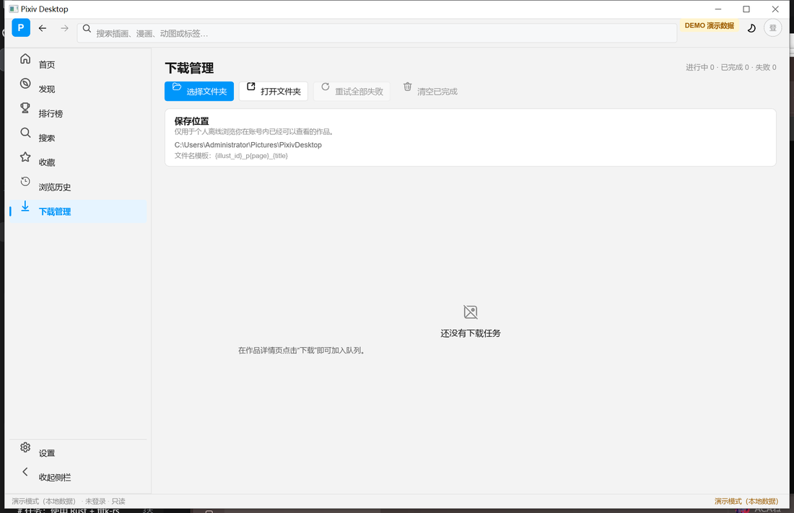
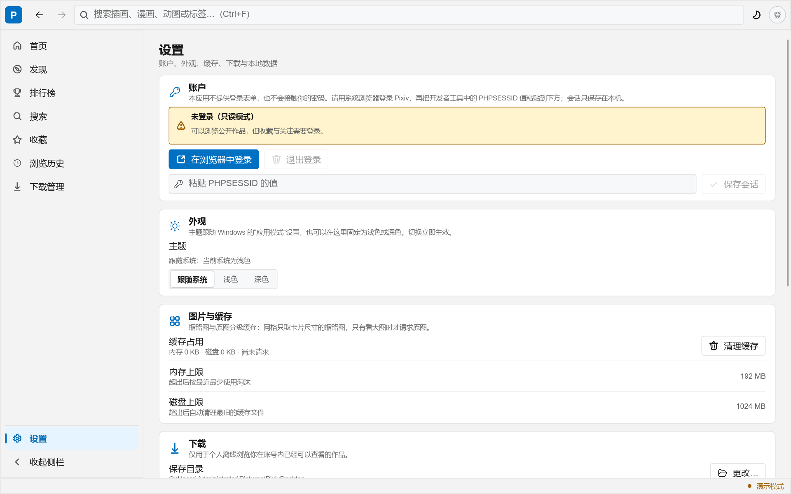

# Pixiv Desktop

A native desktop client for [Pixiv](https://www.pixiv.net/), built with **Rust + Slint**.
No Electron, no CEF, no Tauri, no WebView — the UI is compiled Slint drawing directly
through a GPU/software renderer.

Visual target: **70 % Windows 11 WinUI 3 / Fluent Design 2 + 30 % Pixiv web**. The
shell is a native desktop one — NavigationView-style rail with a compact mode, a
command bar with search/back/forward/account, a Settings page built from cards and
segmented controls, InfoBars, flyout-style tooltips, real
hover/pressed/disabled/focus states, and one Light/Dark/System theme that covers
every page. Pixiv supplies the part that matters for browsing: its blue accent, an
illustration-first masonry feed with no chrome competing against the artwork, tag
chips, and the detail page's image-dominant layout with a compact metadata column.

| Home (light) | Home (dark) |
| --- | --- |
|  |  |

| Detail (dark) | Discover |
| --- | --- |
|  |  |

| Downloads | Settings |
| --- | --- |
|  |  |

Screenshots are captured by `tools/shot.ps1` at 1280×800 logical on a 150% DPI
display, cropped to the client area so a pixel can be mapped to a logical
coordinate. The curated set above is tracked; everything else stays local (see
`.gitignore`).

Icon alignment and colour contrast are **measured, not reviewed**:
`tools/verify-icons.ps1` finds glyph ink centres in a real capture and fails if any
of them drifts from its row, and `cargo test` checks WCAG contrast ratios, the
"no raw glyph outside the icon containers" rule, the `#RRGGBBAA` byte order of
translucent colours, and that no `key-pressed` handler compares against a key
*name*. All of it is described in [`docs/UI-NOTES.md`](docs/UI-NOTES.md) § 7–9.

The engineering record for the layout work — root causes, fixes and what could
not be verified here — is in [`docs/UI-NOTES.md`](docs/UI-NOTES.md).

---

## 1. What works

| Area | Status |
| --- | --- |
| Native window, Fluent shell, collapsible nav rail, responsive reflow | **Implemented** |
| Light / Dark / **System** theme (follows the Windows app mode), switchable at runtime, persisted | **Implemented** |
| Illustration grid with height-balanced masonry (per-card aspect ratio, no cropping, column count measured from the real content box) | **Implemented** |
| Demo Mode with procedurally generated artwork | **Implemented** |
| Real Pixiv data: illustration detail, page list, search, ranking, artist work ids, tag metadata | **Implemented** (verified against the live API) |
| Zoomable image viewer: wheel zoom anchored at cursor, drag pan, double-click toggle, fit / 1:1, fullscreen | **Implemented** |
| Image pipeline: priority queue, single-flight, memory LRU + disk tier, generated fallbacks | **Implemented** |
| Local SQLite: search history, view history, settings, download records — and a History page that reads them back | **Implemented** |
| Download queue: bounded concurrency, filename templates, cancel / retry, duplicate detection, atomic writes | **Implemented** |
| Ugoira decode + timing + GIF export | **Implemented** (library + tests; see limits) |
| Session login via system browser + `PHPSESSID` | **Implemented** |
| Bookmark / follow mutations | **Implemented, unverified against a live session** |
| Novel reader | **Placeholder** (structured page, opens the official page) |
| Comments, "related works", `/ajax/discovery/artworks` | **Not available** — no usable endpoint shape found |

### Honest limits

These are real, not hedging. They are listed because a client that quietly guesses is
worse than one that says what it does not know.

1. **Pixiv has no public third-party OAuth registration.** There is no client
   credential a self-built desktop client can legitimately hold. The working credential
   is therefore the session cookie from the user's own browser. This app never renders a
   login form and never sees a password.
2. **`cargo clippy` cannot run in this build environment.** MSYS2's `cargo-clippy`
   re-executes an MSVC rustup toolchain and dies with `linker link.exe not found` before
   reaching any project code; this reproduces on dependency-only crates. The equivalent
   gate that *does* run, and was used for every crate here, is:
   ```
   $env:RUSTC_WORKSPACE_WRAPPER="C:\msys64\ucrt64\bin\clippy-driver.exe"
   cargo check --workspace --all-targets
   ```
   This was verified to emit genuine clippy lints (a probe crate produced
   `clippy::bool_comparison` and `clippy::unnecessary_first_then_check`), not a plain
   `rustc` check.

   One catch, found while writing `tools/gates.ps1`: `RUSTC_WORKSPACE_WRAPPER` is not
   part of cargo fingerprints, so on an already-built tree this command prints
   `Finished` and lints nothing. The gate therefore points `CARGO_TARGET_DIR` at
   `target/lint` so it always has artifacts to produce; a deliberate
   `bool_comparison` probe was used to prove it reports lints. CI runs plain
   `cargo clippy -D warnings` on an MSVC toolchain instead.
3. **Bookmark and follow POSTs are implemented from observed request shapes but could
   not be confirmed end-to-end**, because no credential was available to verify a success
   response. They never fake success: an error surfaces as an error, and a bookmark can
   only change state after the server confirms it.
4. **`/ajax/discovery/artworks`, related works and comments returned no usable shape**
   (400/404 for every parameter combination tried). Discovery is therefore composed from
   ranking + search + tag metadata rather than guessed. See `docs/API-NOTES.md`.
5. **Native folder picker — implemented** (`SHBrowseForFolderW`, the resizable shell
   dialog). The chosen directory is persisted and applies to the next task immediately;
   `DownloadManager::set_directory()` exists, so no restart is needed.
6. **Ugoira — static preview plus GIF export.** The detail page shows ugoira works as
   still frames and offers **导出动图 GIF**, which fetches the archive, rebuilds the film
   with `crates/pixiv-ugoira` and writes a GIF next to your other downloads. In-app
   animated playback is still not wired into the viewer.
7. Ugoira export writes **animated GIF only** (WebP animation encoding is not in the
   `image` crate).
8. **The layout is measured, not assumed.** Slint reports the content box it actually
   resolved and Rust derives the column count from that number; there is no polling and
   no second source of truth for the window width. The shell's three rows are pinned by
   measurement, not by stretch: see `docs/UI-NOTES.md` § 3 for the constraint-propagation
   bug that used to leave the bottom half of a maximised window unpainted, and § 6 for the
   harness that now proves it is gone (`tools/verify-layout.ps1`: 8 pages × 3 sizes, all
   with `gap=0`).
9. **The system-theme watcher polls, and says so.** Slint 1.18 exposes no colour-scheme
   notification and no reachable window procedure, so while the theme mode is `System` a
   5s timer reads one registry DWORD (`AppsUseLightTheme`). It stops itself the moment a
   fixed theme is chosen. A push notification would need a raw window procedure, which
   this app does not have because it keeps the native frame.
10. **Almost nothing is reachable from the keyboard yet.** The command bar and the
    settings rows respond to the pointer; the navigation rail, the artwork grid,
    the tag chips, the toggles and the segmented control are `TouchArea` only, and
    there is no `accessible-*` attribute anywhere in `ui/`. Tab therefore cycles
    between `AppButton`s. This is the next round, not a design choice: every
    control needs a focus scope, a visible focus ring and a role.
11. **1920×1080 at 150% DPI was not captured.** That needs a 2880×1620 physical client
   area and this screen is 2560×1600, so `tools/verify-icons.ps1` reports the clamp and
   skips instead of measuring a truncated frame. Every other size in the matrix was
   measured.

---

## 2. Build and run

Requires a Rust toolchain (developed on 1.98.1) and, on Windows, a C toolchain for
`rusqlite`'s bundled SQLite (UCRT64 gcc works).

```powershell
cargo build --release
cargo run --release
```

The debug binary also runs and is what the screenshots above were taken with.

### Visual verification

Layout claims are checked against the screen, not against a compiler exit code:

```powershell
# one screenshot, ground truth (BitBlt of the window rect, cropped to the client
# area; a sidecar JSON records the scale factor and the screen bounds)
pwsh -File tools/shot.ps1 -Page home -Mode maximize -Out docs/screenshots/home.png
pwsh -File tools/shot.ps1 -Page settings -Mode size -Size 1024x768 -Dark -Out .../s-dark.png

# a face and a work cannot be reached without input, so both have a deep link:
$env:PIXIV_DESKTOP_START_USER="104439010"; pwsh -File tools/shot.ps1 -Page profile ...

# tooltips only appear on hover, which this host cannot synthesise. -Tip comes
# from PIXIV_DESKTOP_TIP=1 and raises one over the back button for capture.
$env:PIXIV_DESKTOP_TIP="1"; pwsh -File tools/shot.ps1 -Page home ...
pwsh -File tools/shot.ps1 -Page detail -Illust 700000003 -Dark -Out .../detail.png

# every page x every size, asserting the shell invariant from the app's own trace
pwsh -File tools/verify-layout.ps1        # 24 checks: 8 pages x 3 sizes

# icon alignment, measured from pixels rather than from the Slint source
pwsh -File tools/verify-icons.ps1         # add -Size 800x600 / -Dark
```

`shot.ps1` restores the window before resizing (a resize delivered to a
never-restored window is dropped by the backend) and copies the screen rather than
calling `PrintWindow`, which renders the app's own surface and can therefore lie
about layout.

### Verification gates

```powershell
# every gate, in order, with per-gate timing - this is the list
pwsh -File tools/gates.ps1

# or one at a time
cargo fmt --all -- --check
cargo test --workspace                       # 265 tests; 10 are design rules
cargo build --release

# lint (see limit 2 for why not `cargo clippy`)
$env:RUSTC_WORKSPACE_WRAPPER="C:\msys64\ucrt64\bin\clippy-driver.exe"
cargo check --workspace --all-targets
```

`.github/workflows/ci.yml` runs the same gates on `windows-latest` for every push:
fmt, the test suite, `cargo clippy -- -D warnings` and a release build. The live
suite stays inert without `PIXIV_LIVE_PHPSESSID`, so CI never talks to pixiv.net.

### Live tests against the real service

The suite above never opens a socket. There is a second suite that talks to
`www.pixiv.net` with a real session, and it is **inert unless you opt in**, so
`cargo test` can never pick it up by accident:

```powershell
$env:PIXIV_LIVE_PHPSESSID = '<your PHPSESSID value>'
cargo test -p pixiv-api --test live -- --test-threads=1
```

It reads the cookie from the environment only and never writes it anywhere. The
write tests follow read → mutate → **re-read** → restore → re-read, and refuse to
touch a target that is already in the wanted state, so running them does not
leave changes on the account.

`docs/NETWORK-TEST-REPORT.md` records what a full live run against the real
service produced, and `tools/gui-lib.ps1` is the UI Automation driver used to
click through the actual Slint window.

---

## 3. Signing in

Pixiv issues no OAuth client credentials to third-party desktop clients, so this client
reuses the session you already have:

1. Click **在浏览器中登录** in Settings — it opens `pixiv.net` in your **system browser**.
2. Sign in there as usual.
3. Open DevTools → Application → Cookies → `https://www.pixiv.net` → copy the value of
   `PHPSESSID`.
4. Paste it into the session field and press **保存会话**.

The app validates the cookie against a real authenticated endpoint before storing it, and
writes it to `session.bin` in the app data directory, sealed with DPAPI
(`CryptProtectData`, user-scoped) so the file is useless on another account or machine;
on non-Windows targets it falls back to a `0600` file. It is never written to SQLite and
never logged. **退出登录** deletes the file and reverts to Demo Mode.

Nothing about the app is required to sign in: detail pages, pages, search, ranking and
artist work lists all work unauthenticated.

---

## 4. Demo Mode

Demo Mode exists so the UI is fully explorable with no account and no network.

* Every demo URL uses the `demo://` scheme, so any code path reaching the network with
  demo data is an obvious bug.
* Every demo title carries a `[DEMO]` prefix, the top bar shows a **DEMO 演示数据** badge
  and the status bar reads **演示模式（本地数据）**.
* Artwork is generated procedurally at runtime from a seeded PRNG — no third-party imagery
  is bundled, so there is no licensing question.
* Demo Mode is a separate data source; it never parses or imitates a Pixiv response.

---

## 5. Architecture

```
pixiv-desktop      UI (Slint) + application wiring
├── pixiv-demo     demo catalogue + procedural artwork
├── pixiv-download download queue, filename templates
├── pixiv-image    priority cache: memory LRU + disk tier + single-flight
├── pixiv-store    SQLite persistence
├── pixiv-api      HTTP transport: session, retry, rate limiting
└── pixiv-types    wire + domain contracts (no I/O, no UI)
```

Dependencies point one way; `pixiv-types` depends on nothing but `serde`.

**Why a data-contract crate.** Pixiv's JSON is inconsistent in ways that are only
discoverable by observing it: ids are strings on `ajax/*` but numbers on `ranking.php`;
`illust_detail.tags` is a single object while other payloads send arrays; `ranking.php`
sends `"illust_type":"0"` as a string; `mime_type` is snake_case on one endpoint only;
`createDate` is sometimes an object. All of that is normalised exactly once, in
`pixiv-types`, and pinned by tests that parse **real captured responses** in `fixtures/`.
When Pixiv changes a payload, those tests fail before the UI does.

**Threading.** The Slint event loop owns the main thread. One tokio runtime handles
network, decode and database work. Slint models are `!Send`, so background tasks return
only plain bytes and the UI thread builds `slint::Image` values — no pointer sharing, no
locks around models.

**Why native window decorations.** Slint can draw a custom title bar with
`no-frame: true`, but dragging, Snap Layouts, per-monitor DPI and accessibility then all
have to be rebuilt on `Window::set_position`, which is jittery and loses Win11 snapping.
The native frame is kept and Fluent chrome is drawn inside it.

**Tooltips.** One `HoverTip` for the whole window, declared in `main.slint` after
every page and fed by the `Tip` global in `ui/tip.slint`. A tooltip is the only
element that must be drawn *outside* the control that owns it, and a child element
can neither escape an ancestor `clip` nor paint over a sibling declared later -
both of which had silently removed the affordance (see `docs/UI-NOTES.md` § 11).

**Icons.** Generated by `tools/fetch_icons.ps1` from
[Microsoft Fluent UI System Icons](https://github.com/microsoft/fluentui-system-icons)
(MIT). Only the path geometry is embedded, emitted as Slint `Path` elements, so icons
inherit theme colour and stay crisp at any DPI. No emoji, no hand-drawn substitutes.

A glyph is never positioned by hand: `IconPresenter` centres one inside a box the
caller owns, `IconSlot` centres one on the row it sits in, and a test fails the build
if any other file names `FluentGlyph` directly. Two measured facts made that rule
necessary — a `Path` defaults to `(0,0)` regardless of its size, and a fixed-height
child of a `HorizontalLayout` is top-aligned, not centred. See
[`docs/UI-NOTES.md`](docs/UI-NOTES.md) § 7.

Full detail: [`docs/ARCHITECTURE.md`](docs/ARCHITECTURE.md) ·
API observations: [`docs/API-NOTES.md`](docs/API-NOTES.md)

---

## 6. Keyboard shortcuts

| Key | Action |
| --- | --- |
| `Ctrl+F` | Focus search |
| `Ctrl+K` | Focus search (the other half of the pair every search box has) |
| `Alt+←` / `Alt+→` | Back / forward through page history |
| `Ctrl+1` … `Ctrl+7` | Home, Discover, Ranking, Bookmarks, History, Downloads, Settings (`Ctrl+,` also works for Settings) |
| `Ctrl+R` | Refresh the page in front of you: the feed on a feed page, the work on the detail page, the queue on downloads |
| wheel | Zoom the viewer, anchored at the cursor |
| double-click | Toggle zoom at the cursor |
| `F` | Fit to window |
| `1` | Actual size |
| `F11` | Fullscreen |

---

## 7. Legal

This is an unofficial client and is not affiliated with Pixiv Inc. It reads data the
signed-in user can already view in their own account, for personal browsing and offline
use. It deliberately contains **no bulk-scraping facilities** (no artist-wide crawlers, no
pagination bots) and no access-control bypass. Respect the rights of the artists whose
work you view.
